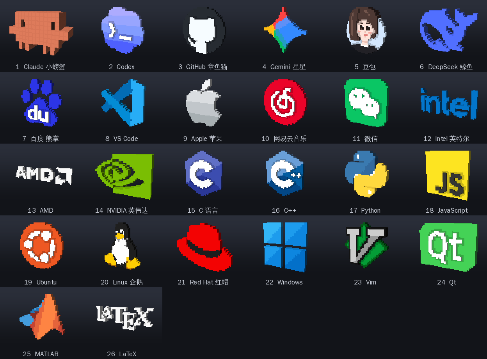
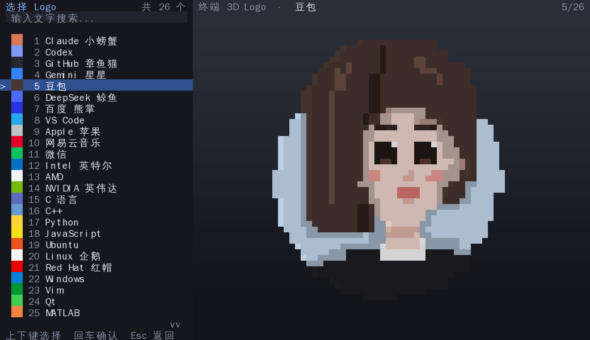

# 终端 3D Logo

在终端里渲染**可以用鼠标交互的 3D 像素风 Logo**。灵感来自新版 Codex CLI 新会话页面上那个可以互动的像素 Logo。

- 纯 Python 编写，只用标准库，**不需要安装任何第三方依赖**
- 像素画被挤出成 3D 体素，带透视、光照、浮雕和像素网格线
- 在终端的**备用缓冲区**中渲染，退出后终端内容原样恢复
- 直接输出 24 位真彩色，用半块字符 `▀` 让每个字符格显示上下两个像素
- 内置 26 个 Logo，界面为中文





## 快速开始

```bash
python3 logo3d.py            # 不带参数：先打开 Logo 选择列表
python3 logo3d.py claude     # 直接显示 Claude 小螃蟹
python3 logo3d.py 豆包        # 中文名、别名、序号都可以
python3 logo3d.py 6          # 第 6 个：DeepSeek 鲸鱼
```

也可以安装成命令：

```bash
pip install .
logo3d github
```

或者以模块方式运行：`python3 -m terminal_logo vim`。

**环境要求**：Python 3.6+，以及支持 24 位真彩色和鼠标上报的终端，例如 iTerm2、Kitty、WezTerm、Alacritty、
GNOME Terminal、Konsole、Windows Terminal、VS Code 内置终端等。

## 交互操作

| 鼠标 | 作用 |
| --- | --- |
| 左键单击 | 水平旋转 360°：加速很快，减速很慢 |
| 左键拖动 | 3D 检视，自由旋转（松手后带惯性） |
| 右键拖动 | 平移（中键拖动、Ctrl / Alt + 左键拖动也可以） |
| 滚轮 | 以鼠标所在位置为中心缩放 |

| 按键 | 作用 |
| --- | --- |
| 方向键 | 旋转 15° |
| Shift + 方向键 | 平移 |
| `+` / `-` | 放大 / 缩小 |
| 空格 / 回车 | 水平旋转一圈 |
| `R` | 重置视角 |
| `A` | 自动旋转 开 / 关 |
| `G` | 像素网格线 开 / 关 |
| `B` | 切换背景（深色渐变 / 纯黑 / 浅色 / 终端默认） |
| `[` / `]` | 减小 / 增加厚度 |
| `N` / `P` | 下一个 / 上一个 Logo |
| `Tab` / `L` | 打开 Logo 列表 |
| `F` | 在标题栏显示帧率 |
| `H` / `?` | 显示 / 隐藏帮助 |
| `Q` / `Esc` | 退出（`Ctrl+C` 任何时候都能退出） |

**Logo 列表**里：上下键（或滚轮）选择，右侧实时预览；直接输入文字可以搜索（支持中文、别名）；
回车或单击确认；`Esc` 先清空搜索，再按一次返回（启动时打开的列表按 `Esc` 会退出程序）。

## 命令行参数

```
用法：logo3d.py [选项] [logo]

  logo              要显示的 Logo（名称、别名或序号）；省略则先打开选择列表

  -h, --help        显示帮助并退出
  -l, --list        列出所有可用的 Logo 并退出
  -d, --depth N     Logo 厚度（体素数，1-16）
  -b, --bg 主题     背景：dark 深色渐变（默认）/ black 纯黑 / light 浅色 / term 终端默认
  --no-grid         关闭像素网格线
  --no-intro        启动时不播放旋转动画
  -a, --auto        启动后自动旋转
  --fps N           最高帧率（默认 60）
  -p, --print       不进入交互界面，直接向标准输出打印一帧静态图像
  --size 宽x高      配合 --print：图像大小（单位：字符），默认取终端大小
  --yaw 角度        配合 --print：水平旋转角度
  --pitch 角度      配合 --print：俯仰角度
  -V, --version     显示版本号
```

`--print` 适合在脚本、MOTD 或终端欢迎语里使用，例如：

```bash
python3 logo3d.py linux --print --size 48x16 --yaw -25 --pitch 12
```

## 内置 Logo

| 序号 | 参数 | 名称 | 常用别名 |
| --- | --- | --- | --- |
| 1 | `claude` | Claude 小螃蟹 | `clawd` `claude-code` `螃蟹` |
| 2 | `codex` | Codex | `openai` |
| 3 | `github` | GitHub 章鱼猫 | `octocat` `章鱼猫` |
| 4 | `gemini` | Gemini 星星 | `google` `星星` |
| 5 | `doubao` | 豆包（拟人化女孩头像） | `豆包` |
| 6 | `deepseek` | DeepSeek 鲸鱼 | `whale` `鲸鱼` |
| 7 | `baidu` | 百度 熊掌 | `百度` `熊掌` |
| 8 | `vscode` | VS Code | `code` |
| 9 | `apple` | Apple 苹果 | `mac` `苹果` |
| 10 | `netease` | 网易云音乐 | `ncm` `163` `网易云` |
| 11 | `wechat` | 微信 | `weixin` `wx` |
| 12 | `intel` | Intel 英特尔 | `英特尔` |
| 13 | `amd` | AMD | |
| 14 | `nvidia` | NVIDIA 英伟达 | `nv` `英伟达` |
| 15 | `c` | C 语言 | `clang` |
| 16 | `cpp` | C++ | `c++` `cxx` |
| 17 | `python` | Python | `py` |
| 18 | `js` | JavaScript | `javascript` |
| 19 | `ubuntu` | Ubuntu | |
| 20 | `linux` | Linux 企鹅 | `tux` `企鹅` |
| 21 | `redhat` | Red Hat 红帽 | `rhel` `红帽` |
| 22 | `windows` | Windows | `win` |
| 23 | `vim` | Vim | `nvim` |
| 24 | `qt` | Qt | |
| 25 | `matlab` | MATLAB | `mathworks` |
| 26 | `latex` | LaTeX | `tex` |

完整列表（含全部别名）可用 `python3 logo3d.py --list` 查看。

## 实现原理

1. **像素画**：每个 Logo 是一张 16~44 像素宽的像素画（见 `terminal_logo/logos.py`），每种颜色可以设置浮雕高度，
   比如 GitHub 的猫、Codex 的 `>_` 会比底板凸出一格，小螃蟹的眼睛凹进去一格。
   部分 Logo 还为背面单独换色：转到背面时，豆包看到的是后脑勺的头发，小螃蟹的背面没有眼睛。
2. **建模**（`model.py`）：把像素画挤出成体素，同一高度的顶面合并成一个大矩形，相邻高度差处生成侧壁，
   并把连续的侧壁合并成长条，一个 Logo 通常只有几十到两百多个面。
3. **渲染**（`render.py`）：纯 Python 软件光栅化。每个面经透视投影后逐扫描线填充，用逆单应矩阵把屏幕像素映射回面上的
   坐标查表取色，深度缓冲保证遮挡正确；按面的朝向计算漫反射 + 高光，再加上浮雕边缘的环境光遮蔽和随大小渐显的像素网格线。
4. **输出**（`term.py`）：每个字符格用 `▀` 显示上下两个像素（前景色 + 背景色）；只重绘与上一帧不同的部分，
   并用同步输出（DEC 2026）避免闪烁。在常见终端尺寸下单帧渲染只需几毫秒，可以跑满 60 帧。
5. **交互**（`app.py`）：SGR 1006 鼠标协议；姿态用四元数表示，拖动绕屏幕坐标轴旋转；单击旋转使用
   “前 14% 时间快速加速、之后三次曲线缓慢减速”的速度曲线。

## 项目结构

```
logo3d.py               启动脚本
terminal_logo/
  app.py                界面、交互、动画、命令行参数
  logos.py              26 个 Logo 的像素画数据与查找
  model.py              像素画 → 体素模型
  render.py             软件光栅化渲染器
  term.py               终端控制、输入解析、差异输出
tests/test_basic.py     基础测试（python3 -m unittest discover -s tests）
```

## 添加新的 Logo

在 `terminal_logo/logos.py` 的 `LOGOS` 列表里追加一项即可：

```python
Logo(
    'heart', '爱心', ('love', '心'),
    palette={'r': ('#E53950', 0), 'w': ('#FFFFFF', 1)},   # 字符: (颜色, 浮雕高度)
    depth=3,                                              # 可选：底板厚度
    art="""
.rr...rr.
rrrr.rrrr
rwrrrrrrr
rrrrrrrrr
.rrrrrrr.
..rrrrr..
...rrr...
....r....
"""),
```

`.` 表示空白；`back_map={'w': 'r'}` 可以让背面的某些颜色换成别的颜色。

## 说明与已知限制

- 程序直接输出 24 位真彩色，不做检测；不支持真彩色的终端颜色会不正确。
- 少数终端会拦截 Shift + 拖动用于选中文本，所以平移请优先用右键或中键拖动。
- 如果终端把“宽度不明确”的字符设置成双宽（部分 CJK 环境的选项），`▀` 会占两格导致画面错乱，请改回单宽。
- Windows 下使用 Windows Terminal 的 VT 输入模式读取键盘和鼠标，这部分没有在真机上测试过。
- 各 Logo 的商标与版权归其各自所有者，本项目中的像素画仅用于学习和娱乐。
